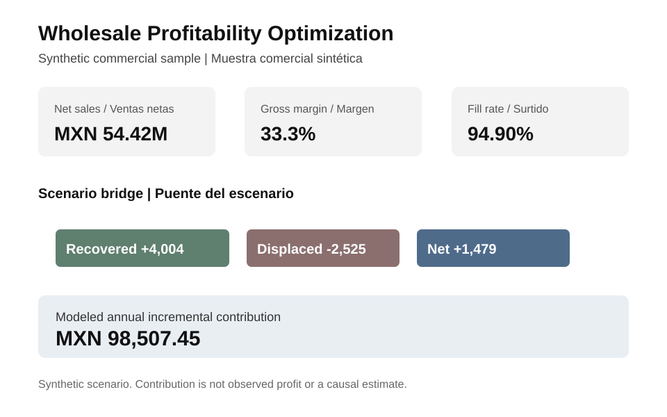

# Wholesale profitability commercial sample | Muestra comercial de rentabilidad mayorista

## English

**Supports:** U10 Commercial profitability.

This sample uses a fully synthetic wholesale operation with four branches, one distribution center, 120 products and one year of simulated 2025 data. The case connects sales, cost of sales, gross margin, fulfillment, inventory and a replenishment scenario.

Verified results include **MXN 54.42 million** in net sales, **33.3% gross margin**, **94.90% fill rate**, **4,004 recovered units**, **2,525 displaced units**, **1,479 net additional units**, and **MXN 98,507.45** in modeled annual incremental contribution before costs not represented in the model.

**Example deliverable:** profitability summary, margin and fulfillment review, scenario bridge, and a concise management interpretation of whether recovered volume creates economic value.

**Main limit:** all data and scenario assumptions are synthetic. The modeled contribution is not observed profit and is not a causal estimate.

## Español

**Respalda:** U10 Rentabilidad comercial.

Esta muestra utiliza una operación mayorista completamente sintética con cuatro sucursales, un centro de distribución, 120 productos y un año simulado de datos 2025. El caso relaciona ventas, costo de venta, margen bruto, surtido, inventario y un escenario de reposición.

Los resultados verificados incluyen **MXN 54.42 millones** en ventas netas, **33.3 % de margen bruto**, **94.90 % de nivel de surtido**, **4,004 unidades recuperadas**, **2,525 unidades desplazadas**, **1,479 unidades adicionales netas** y **MXN 98,507.45** de contribución incremental anual modelada antes de costos no representados.

**Ejemplo de entrega:** resumen de rentabilidad, revisión de margen y surtido, puente del escenario e interpretación gerencial breve sobre si el volumen recuperado genera valor económico.

**Límite principal:** todos los datos y supuestos del escenario son sintéticos. La contribución modelada no es utilidad observada ni una estimación causal.

Carlos Segura
